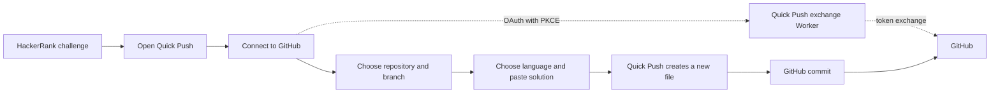

# Quick Push

**Save HackerRank solutions as new files in a GitHub repository—without leaving your challenge.**

Quick Push is a Chrome extension for choosing a GitHub repository and branch, pasting a solution, and creating a new file in a few clicks. You stay in control of what gets saved and where.

> **Project status:** Quick Push is not currently distributed through the Chrome Web Store. Follow the [installation steps](#install-the-extension) to build and load it locally. A configured GitHub App and OAuth exchange Worker are required to connect an account.

## Highlights

- **Work where you solve:** Open the Quick Push panel on a HackerRank challenge.
- **Choose the destination:** Select an accessible GitHub repository and branch.
- **Save a new solution file:** Pick a language and filename, then push your pasted code as a commit.
- **Avoid accidental overwrites:** Quick Push checks the target path before creating a file.
- **Connect securely:** GitHub authorization uses OAuth with PKCE; the GitHub App client secret stays on the server.

## How it works



## Install the extension

### Requirements

- Google Chrome or another Chromium browser that supports Manifest V3 extensions.
- Node.js and npm.
- A configured Quick Push GitHub App and OAuth exchange Worker. The example configuration contains placeholders and is not sufficient to connect an account by itself.

### Build and load locally

1. Clone the project and install dependencies:

   ```bash
   git clone https://github.com/devcodes2108/quick-push.git
   cd quick-push
   npm ci
   ```

2. Create your local build configuration by copying `.env.example` to `.env`. Set the public GitHub App client ID, installation URL, and HTTPS OAuth exchange URL:

   ```env
   VITE_GITHUB_APP_CLIENT_ID=your_github_app_client_id
   VITE_GITHUB_APP_INSTALL_URL=https://github.com/apps/your-app-slug/installations/new
   VITE_AUTH_EXCHANGE_URL=https://your-worker.example.workers.dev/oauth/exchange
   ```

   These are public build settings, not secrets. **Never put a GitHub App client secret, access token, authorization code, or PKCE verifier in `.env` or extension files.** The client secret belongs in the Worker’s encrypted secret storage.

3. Build the extension:

   ```bash
   npm run build
   ```

4. Open `chrome://extensions` in Chrome, enable **Developer mode**, click **Load unpacked**, and select this project’s `dist` folder.

5. Open a HackerRank challenge and click the Quick Push toolbar icon. Choose **Connect with GitHub**, complete GitHub’s authorization, pick a repository and branch, select a language, paste your solution, and click **Push to GitHub**.

If GitHub connection is not configured for your build, ask the project maintainer for a configured distribution. For maintainer setup—including GitHub App and Worker configuration—see [worker/README.md](worker/README.md).

## Security and permissions

- Quick Push uses GitHub authorization with **PKCE (S256)** and validates the authorization state and callback URI.
- The GitHub App client secret is kept by the OAuth exchange Worker; it is not embedded in the extension.
- The extension uses the GitHub authorization you grant to list accessible repositories and branches and create commits.
- Access tokens are stored in Chrome session storage and removed when you disconnect or the browser session ends.
- Quick Push does not read or submit challenge code automatically. You paste the solution you want to save.
- Existing files are not overwritten.

Review the permissions in [`public/manifest.json`](public/manifest.json) before building. The extension requires access to HackerRank pages, GitHub, the configured exchange Worker, and Chrome identity/session APIs.

## Development

```bash
npm ci
npm run typecheck
npm run lint
npm test
npm run build
```

The test command runs the extension and Worker test suites. Worker deployment is a separate maintainer operation; building or testing the extension does not deploy the Worker.

## License

No license is currently specified. Unless a license is added, standard copyright restrictions apply; please contact the repository owner before redistributing this project.
